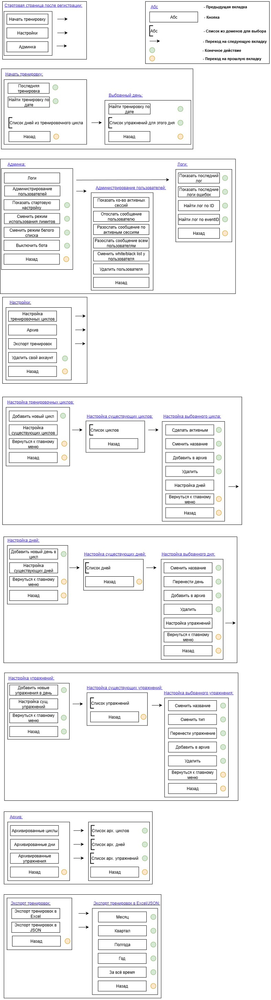

# :robot: WorkoutStorageBot

Простой Telegram-бот для записи, хранения и просмотра результатов тренировок

## :pushpin: Описание

**WorkoutStorageBot** — умеет:

- Хранить результаты тренировок, разбивая их на циклы и дни
- Показывать последние данные тренировок, а также фильтровать результаты по дням
- Экспортировать данные тренировок в файлы .xlsx и .json
- Динамически настраивать циклы, дни, упражнения

---

## :rocket: Quick Start

Чтобы быстро запустить бота, следуйте этим шагам:

### 1. Клонируйте репозиторий

```
git clone https://github.com/Grawter/WorkoutStorageBot.git
```

### 2. Заполните стартовую настройку

```
cd ./WorkoutStorageBot/src/WorkoutStorageBot/Application/StartConfiguration
nano appsettings.json
```

Укажите токен своего Telegram-бота в Bot->Token

```
{
  "DB": {
    "EnsureCreated": "True",
    "Server": "",
    "Database": "data/test.db",
    "UserName": "",
    "Password": ""
  },

  "Bot": {
    "Token": "<Your telegram bot token>",
    "WhiteListIsEnable": "False",
    "OwnersChatIDs": [ "000000000" ],
    "IsNeedCacheContext": "False",
    "IsNeedLimits": "False"
  },

  "Notifications": {
    "NotifyOwnersAboutCriticalErrors": "False",
    "NotifyOwnersAboutRuntimeErrors": "False"
  },

  "LogInfo": {
    "MainRuleLog": {
      "DBLogLevels": [ "Error", "Critical" ],
      "ConsoleLogLevels": [ "All" ]
    }
  }
}
```

### 3. Соберите и запустите бота

```
cd ../../..
docker-compose up -d
```

### 4. Создайте свой первый тренировочный цикл


## :world_map: Карта кнопок


## :jigsaw: Полное описание настройки appsettings.json

```
{
  // Настроить считывание настроек под свои нужды можно в ConfigurationManager -> GetConfiguration

  /*
  Настройки подключения к БД.
  По умолчанию используется SQLite, в случае необходимости можно поменять DBProvider: Program -> CreateHostAndSetDI.
  В случае необходимости можно написать свою реализацию строки подключения: ConfigurationData -> DbSettings -> ConnectionString.

  EnsureCreated - Требуется ли первичная инициализация БД при старте приложения (Database.EnsureCreated()) [Необязательно] [По умолчанию - False]
  Server - Сервер DB [Необязательно]
  Database - Название DB. Путь должен находиться в папке data, т.к. она монтируется как volume [Обязательно]
  UserName - УЗ для подключения к DB [Необязательно]
  Password - УЗ для подключения к DB [Необязательно]
  
  После инициализации всех зависимостей значения UserName и Password будут заменены на маскированные значения в модели конфигурации. Подробнее: ConfigurationManager -> SetCensorToDBSettings.
  */
  "DB": {
    "EnsureCreated": "False",
    "Server": "",
    "Database": "data/<someName>.db",
    "UserName": "",
    "Password": ""
  },

  /*
  Настройки функциональности бота.

  Token - Токен для управления ботом [Обязательно]
  WhiteListIsEnable - Нужно ли включать режим белого списка [Обязательно]
  OwnersChatIDs - Telegram ID админов бота (для доступа к админке) [Обязательно]
  IsNeedCacheContext - Нужно ли включать кэш для глобального контекста (ContextKeeper) [Обязательно]
  При включённом режиме кэш хранится 6 часов, если к контексту не было обращений.
  IsNeedLimits - Нужно ли включать режим лимитов. [Необязательно] [По умолчанию - False]
  IsSupportOnlyKnownTypes - Поддерживать только известные типы обновлений (UpdateType.Message, UpdateType.CallbackQuery). [Необязательно] [По умолчанию - True]
  */
  "Bot": {
    "Token": "<Your telegram bot token>",
    "WhiteListIsEnable": "False",
    "OwnersChatIDs": [ "000000000" ],
    "IsNeedCacheContext": "True",
    "IsNeedLimits": "True",
    "IsSupportOnlyKnownTypes": "True"
  },

  /*
  Настройки уведомлений об операциях.

  NotifyOwnersAboutCriticalErrors - Отсылать уведомления админам о критических ошибках в боте [Обязательно]
  NotifyOwnersAboutRuntimeErrors - Отсылать уведомления админам о некритических ошибках в боте [Обязательно]
  */
  "Notifications": {
    "NotifyOwnersAboutCriticalErrors": "True",
    "NotifyOwnersAboutRuntimeErrors": "True"
  },

  /*
  Настройки логгирования приложения.

  Доступные уровни логгирования: Trace, Debug, Information, Warning, Error, Critical, None, All.

  MainRuleLog - Основное правило логгирования. По умолчанию применяется ко всем классам.
  DBLogLevels - Логи с этим уровнем будут записаны в БД [Необязательно]
  ConsoleLogLevels - Логи с этим уровнем будут выведены в консоли [Необязательно]
  
  CustomRulesLog - Кастомное правило логгирования для конкретного класса [Необязательно]
  FullClassName - Полное название класса [Обязательно, если указывается кастомное правило]
  */
  "LogInfo": {
    "MainRuleLog": {
      "DBLogLevels": [ "Error", "Critical" ],
      "ConsoleLogLevels": [ "All" ]
    },

    "CustomRulesLog": [
      {
        "FullClassName": "WorkoutStorageBot.BusinessLogic.Handlers.MainHandlers.PrimaryUpdateHandler",
        "DBLogLevels": [ "Warning", "Error", "Critical" ],
        "ConsoleLogLevels": [ "Warning" ]
      }
    ]
  },

  /*
  AboutBot - Описание, выводимое из меню настройки по кнопке "О боте" [Необязательно]
  */
  "AboutBot": "Some information about <b>bot</b>"
}
```

## :briefcase: Database Schema

```
Domains:
+---------------------+      +-------------------------------+      +---------------------+      +-----------------------+      +------------------------+
|   UserInformation   | 1  * |             Cycle             | 1  * |         Day         | 1  * |       Exercise        | 1  * |     ResultExercise     |
+---------------------+------>-------------------------------+------>---------------------+------>-----------------------+------>------------------------+
| Id (PK) : int       |      | Id (PK) : int                 |      | Id (PK) : int       |      | Id (PK) : int         |      | Id (PK) : int          |
| UserId : long       |      | Name : string                 |      | Name : string       |      | Name : string         |      | Count : int?           |
| FirstName : string  |      | UserInformationId (FK) : int  |      | CycleId (FK) : int  |      | Mode : ExercisesMods  |      | Weight : float?        |
| Username : string   |      | IsActive : bool               |      | IsArchive : bool    |      | DayId (FK) : int      |      | FreeResult : string?   |
| WhiteList : bool    |      | IsArchive : bool              |      |                     |      | IsArchive : bool      |      | DateTime : DateTime    |
| BlackList : bool    |      |                               |      |                     |      |                       |      | ExerciseId (FK) : int  |
+---------------------+      +-------------------------------+      +---------------------+      +-----------------------+      +------------------------+

==========================================================================================================================================================

Infrastructure Tables:
+-------------------------+      +-------------------------------+
|           Log           |      |          ImportInfo           |
+-------------------------+      +-------------------------------+
| Id (PK) : int           |      | Id (PK) : int                 |
| LogLevel : string       |      | DomainType : string           |
| EventID : int?          |      | DomainId : int                |
| EventName : string?     |      | UserInformationId (FK) : int  |
| DateTime : DateTime     |      | DateTime : DateTime           |
| Message : string        |      |                               |
| SourceContext : string  |      |                               |
| TelegramUserId : long?  |      |                               |
+-------------------------+      +-------------------------------+

==================================================================

Enums in Tables:
+------------------+
|  ExercisesMods   |
+------------------+
| Count = 0        |
| WeightCount = 1  |
| Timer = 2        |
| FreeResult = 3   |
+-------------------+
```
### :clipboard: Описание таблиц
**Domains**

- UserInformation — Профили пользователей

- Cycle — Тренировочные циклы пользователей

- Day — Тренировочные дни внутри цикла

- Exercise — Упражнения внутри тренировочного дня

- ResultExercise — Результаты выполнения упражнений

**Infrastructure Tables**

- ImportInfo - Хранит историю об импорте доменных сущностей

- Log - Таблица логов (инфраструктурная, без FK)

## :toolbox: Дополнительная информация

Хранение данных: SQLite + EF
- **WorkoutStorageBot** - Обработка логики бота
- **WorkoutStorageImport** - Утилита для импорта данных тренировок из JSON
- **WorkoutStorageModels** - Модели
- **WorkoutStorageBot.UnitTests** - Unit тесты
- **WorkoutStorageBot.IntegrationTests** - Интеграционные тесты
- **WorkoutStorageBot.E2ETests** - E2E тесты